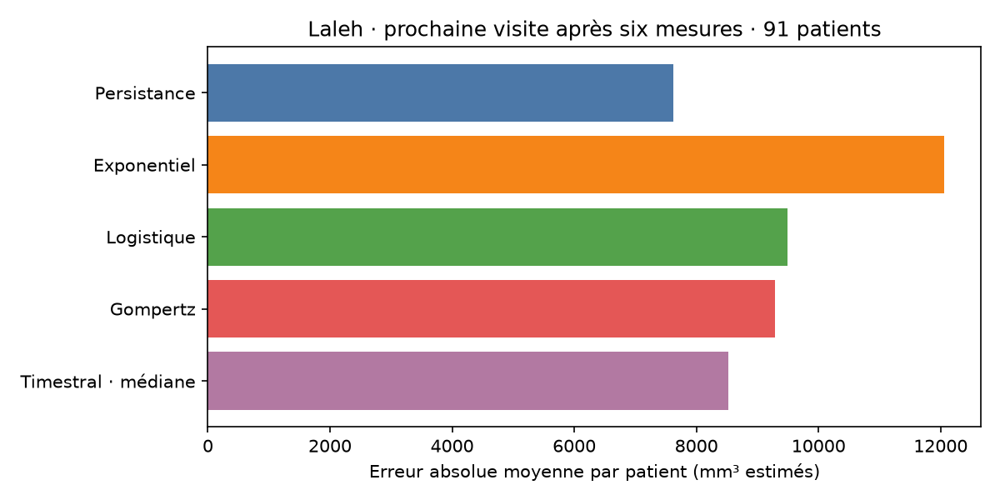

# tumorstral

**Reproducible tumour growth forecasting from longitudinal measurements.**

tumorstral compares individual growth models with zero-shot Timestral forecasts
on preclinical and human tumour trajectories. It combines data quality checks,
patient-level holdouts, probabilistic evaluation and plots of predictions against
observations in a Python package with a reproducible command-line interface.

[Getting started](#getting-started) · [Human trajectories](#human-trajectories) ·
[Documentation](docs/README.md) · [Contributing](CONTRIBUTING.md) ·
[Glossary](src/tumorstral/glossary.md)

## Features

- **Data quality:** preserve original rows, missing values, censored readings,
  duplicate dates and source checksums.
- **Growth models:** persistence, exponential, logistic and Gompertz, fitted
  separately to each available history using SciPy.
- **Probabilistic forecasts:** optional Timestral-5M with frozen weights,
  21 quantiles and an explicit sparse daily observation grid.
- **Comparable evaluation:** common forecast targets, errors weighted equally
  by individual, and paired resampling of individuals.
- **Readable results:** forecast/truth plots, prediction intervals, error
  summaries, coverage diagnostics and a local glossary in exported reports.

This is research software. Clinical performance and suitability for treatment
decisions have not been established.

## Getting started

Install [uv](https://docs.astral.sh/uv/) and Git, then clone the repository:

```sh
git clone https://github.com/xomay/tumorstral.git tumorstral
cd tumorstral
uv sync --locked
uv run tumorstral --help
```

The package supports Python 3.11 or newer. The checkout selects Python 3.14;
`uv.lock` records dependency versions. R is not required to read the example data.

The Python package and command are named `tumorstral`. After updating an existing
checkout, run `uv sync --locked` to install the renamed command. The GitHub repository and local checkout are both named `tumorstral`.
Recorded experiment snapshots retain their original package names and checksums.

Download and explore the preclinical example:

```sh
uv run tumorstral download
uv run tumorstral eda
```

Open `reports/exploration.md` for quality checks, trajectory statistics and figures.
A local [CSV](src/tumorstral/glossary.md#csv) with the documented schema can be supplied
with `uv run tumorstral eda --input /path/to/data.csv`.

## Human trajectories

Install the optional inference dependencies and download the original Laleh
supplement and pinned Timestral weights:

```sh
uv sync --locked --extra timestral
uv run --extra timestral tumorstral human download
uv run --extra timestral tumorstral human audit
uv run --extra timestral tumorstral human split
uv run --extra timestral tumorstral human develop
uv run --extra timestral tumorstral human freeze
uv run --extra timestral tumorstral human evaluate
```

The workflow separates patient allocation, development diagnostics, configuration
freezing and held-out evaluation. Freezing requires a clean Git checkout so each
experiment refers to a committed implementation. The default development run is
a deterministic pilot of 20 patients; evaluation uses the full test partition.

`configs/human.toml` controls the experiment. To use only the four reference
models, copy it and set `timestral.enabled = false`. Raw data, downloaded weights
and complete experiment outputs stay local. After downloading, the analyses can
run offline with `uv run --offline ...`.

## Preclinical benchmarks

```sh
uv run tumorstral baselines split
uv run tumorstral baselines develop
uv run tumorstral baselines freeze
uv run tumorstral baselines evaluate
```

`configs/baselines.toml` defines exact 3-, 7- and 14-day horizons, with at least
six past measurements. The human experiment instead evaluates the next observed
visits at their actual dates. These protocols address different questions and
their scores should not be pooled.

To add zero-shot Timestral on the **same preclinical animals, histories and exact
targets**, use the dedicated configuration:

```sh
uv sync --locked --extra timestral
uv run --extra timestral tumorstral baselines download-model --config configs/preclinical_timestral.toml
uv run --extra timestral tumorstral baselines split --config configs/preclinical_timestral.toml
uv run --extra timestral tumorstral baselines develop --config configs/preclinical_timestral.toml
uv run --extra timestral tumorstral baselines freeze --config configs/preclinical_timestral.toml
uv run --extra timestral tumorstral baselines evaluate --config configs/preclinical_timestral.toml
```

Freeze requires committed code and completed development. Inference then runs
offline with verified local weights. Outputs stay in `reports/preclinical_timestral/`;
the original four-model configuration is preserved. Reports compare all five
models on common targets, retain raw negative Timestral outputs, and include
paired differences against persistence and Gompertz plus interval diagnostics.
This is an exploratory extension made after the classical results were inspected;
see the [extension protocol](docs/preclinical_timestral_protocol.md).
The [recorded INSPECTumours comparison](docs/preclinical_timestral_results.md)
includes point errors, paired differences and raw interval coverage.

## Data and scientific assumptions

| Source | Measurements | Target and time scale |
| --- | --- | --- |
| [INSPECTumours](https://github.com/AstraZeneca/INSPECTumours) | Repeated preclinical tumour measurements | Volume in mm³; days after implantation |
| [Laleh et al.](https://doi.org/10.1371/journal.pcbi.1009822) | Human target-lesion diameters during treatment | Estimated volume `0.5 × diameter_mm³`; actual days relative to treatment |

The human target is a diameter-derived estimate for one lesion, rather than
segmented anatomical volume or total tumour burden. `TOO SMALL TO MEASURE` and
`NOT EVALUABLE` remain missing, not zero. Anonymous identifiers reused across
studies are excluded from predictive experiments.

Each model receives only its available prefix. Future target volumes never
enter its inputs. Targets are not interpolated. Timestral receives a daily grid
with missing-value indicators; its upstream implementation internally carries
past values forward while retaining the mask. Raw negative forecasts and
quantiles remain visible, without silent clipping or external recalibration.

Sources are downloaded separately and checked using
[SHA-256](src/tumorstral/glossary.md#sha-256). Data and model licences are distinct
from the project code licence; see [third-party notices](THIRD_PARTY_NOTICES.md).

## Reference results

In the recorded human experiment, 91 held-out patients had a usable next visit
after six observations. The visit delay had a median of 42 days. The
[mean absolute error](src/tumorstral/glossary.md#mae) was 7,626 mm³ estimated for
persistence and 8,524 mm³ estimated for the Timestral median. Timestral did not
improve point accuracy in that comparison; some raw intervals were wide and
included negative values.



These are results of a specific experiment, not general performance guarantees.
The [human results](docs/human_results.md) and [preclinical results](docs/preclinical_results.md)
include supports, uncertainty diagnostics, execution commits and provenance.
A change to configuration, inputs, implementation or commit creates a new experiment.

## Documentation

Detailed methods and experiment reports are currently written in French.

| Document | Contents |
| --- | --- |
| [Human protocol](docs/human_protocol.md) | Patient split, censored readings, grids, quantiles and metrics |
| [Human results](docs/human_results.md) | Predictions against observations and probabilistic diagnostics |
| [Preclinical protocol](docs/preclinical_protocol.md) | Numerical fits, chronological evaluation and common targets |
| [Preclinical usage](docs/preclinical_usage.md) | Commands, configuration and output files |
| [Preclinical results](docs/preclinical_results.md) | Recorded benchmark and limitations |
| [Data checks](docs/data_checks.md) | Source inspection and exploratory checks |
| [Data guide](data/README.md) | Source formats and provenance |
| [Glossary](src/tumorstral/glossary.md) | Acronyms and evaluation terms |

## Project layout

```text
configs/                   Exploration and forecasting configurations
docs/                      Methods, data checks and reference experiments
src/tumorstral/
    data/                  Data access, adapters and quality checks
    baselines/             Individual mechanistic models
    timestral/             Optional zero-shot forecasting adapter
    evaluation/            Experimental design, metrics and reporting
tests/                     Offline tests using synthetic fixtures
reports/                   Curated figures and local generated analyses
```

## Development

```sh
uv sync --locked
uv run --offline pytest
uv build
```

Tests use synthetic fixtures and mocked downloads; they require neither real
patient data nor model weights. Continuous integration runs tests and builds on
Python 3.11 and 3.14. See [CONTRIBUTING.md](CONTRIBUTING.md) for contributions
and bug reports.

## Licence and attribution

Original tumorstral code is distributed under the [MIT licence](LICENSE).
Datasets, model weights and dependencies retain their own terms. In particular,
Timestral weights use a **Modified MIT licence with additional conditions**;
they are not covered by tumorstral's MIT licence.

Please cite the original data and model sources when reporting results.
Attribution details are in [THIRD_PARTY_NOTICES.md](THIRD_PARTY_NOTICES.md).
