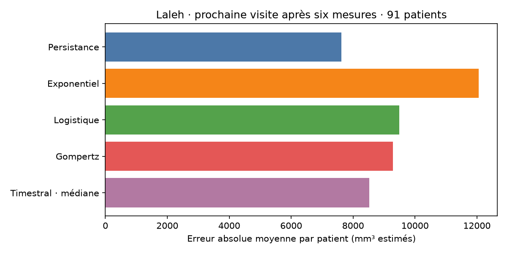
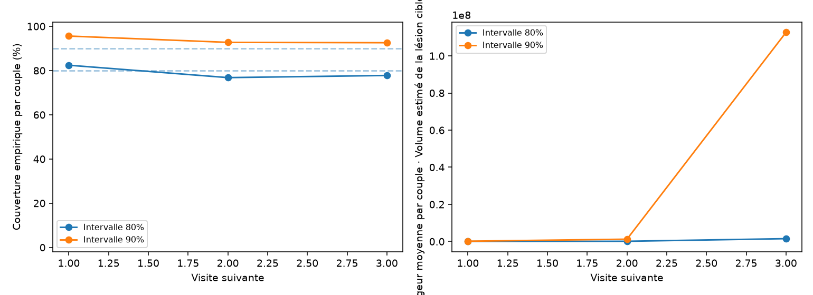
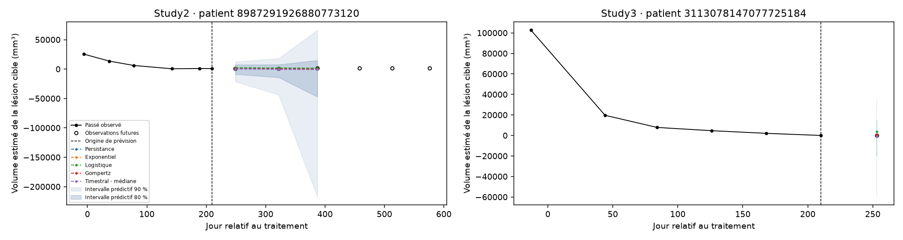
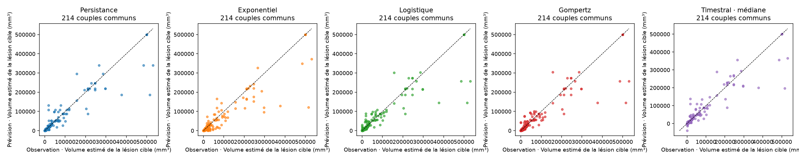
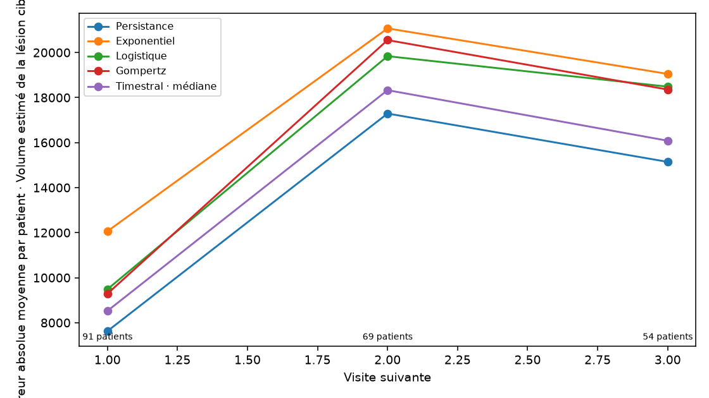

# Laleh — prévisions humaines et comparaison à la vérité publiée

Expérience exécutée le 4 novembre 2026, identifiant `d1acaeaea2b0e3ceb2b0`,
code au commit `88f21c255c7a51bd31ee0d42622a66641bcb9fb5`. Le
[protocole](human_protocol.md) précise les décisions scientifiques ; la
[provenance de cette synthèse](../reports/human_review/provenance.json) contient les
empreintes et les scores exportés. Python 3.14.4, PyTorch 2.15.0+cpu et
Timestral 1.0.0 sont utilisés avec les dépendances figées dans uv.lock.

## Données réellement utilisées

Le supplément original de [Laleh et al., 2022](https://doi.org/10.1371/journal.pcbi.1009822.s006)
contient 8 560 lignes et 1 472 dossiers étude/patient sur cinq études. Il a été
téléchargé directement depuis PLOS ; aucun fichier dérivé n'entre dans l'analyse.
Son empreinte est `ffca72e8b9a54129d2245c315ba89d8169e63dbd2c971119a63f454e5fe63e3d`.

Les jours relatifs au traitement sont conservés. Le volume estimé est calculé
par `0.5 * diamètre_mm**3`, sans normalisation sur l'ensemble des trajectoires.
Il décrit une lésion cible, pas un volume segmenté ni la totalité de la maladie.
Les 62 mentions NOT EVALUABLE, 54 mentions TOO SMALL TO MEASURE et sept
diamètres absents restent distincts de zéro. L'audit conserve les lignes,
les doublons et les coordonnées Excel ; 8 422 lignes sont exploitables selon
les contrôles communs de qualité.

Neuf identifiants anonymes apparaissent dans deux études. Les 18 dossiers
correspondants sont exclus des expériences prédictives, car il est impossible
de démontrer leur indépendance. Ils restent présents dans l'audit.
Les 1 454 autres patients sont répartis en **1 170 de développement et 284 de test**.
Le pilote de développement utilise 20 patients présélectionnés par identité.

## Résultat principal

Après les six premières mesures exploitables, **91 patients** du test disposent
d'une mesure numérique à la visite suivante. Les cinq modèles produisent une
prévision sur ces mêmes 91 couples. Le délai réel est variable : médiane
**42 jours**, minimum 20, maximum 130. Il ne s'agit pas d'un horizon fixe de sept jours.

| Modèle | [MAE](../src/tumortwin/glossary.md#mae), mm³ estimés | [RMSE](../src/tumortwin/glossary.md#rmse), mm³ estimés |
| --- | ---: | ---: |
| Persistance | **7 626,44** | **25 863,83** |
| Exponentiel | 12 061,70 | 32 914,52 |
| Logistique | 9 487,43 | 27 934,20 |
| Gompertz | 9 288,10 | 28 057,36 |
| Timestral, médiane | 8 524,28 | 25 987,68 |

**Timestral n'améliore pas la précision ponctuelle par rapport à persistance
sur ce protocole.** Sa différence d'erreur absolue moyenne à persistance vaut
+897,84 mm³ estimés ; l'intervalle exploratoire à 95 %, par 2 000 tirages
appariés de patients stratifiés par étude, est [+30,36 ; +1 855,74]. Les scores
ne démontrent pas un classement universel ni une aptitude clinique.

## Quantiles et intervalles de Timestral

La [pinball loss](../src/tumortwin/glossary.md#pinball-loss), moyennée sur les
21 quantiles puis par patient, vaut **5 486,12 mm³ estimés** sur le critère principal.
Aucun intervalle artificiel n'est attribué aux quatre modèles déterministes.

| Intervalle nominal | Couverture observée | Largeur moyenne, mm³ estimés |
| --- | ---: | ---: |
| 80 %, quantiles 10–90 % | 82,42 % | 44 888,43 |
| 90 %, quantiles 5–95 % | 95,60 % | 150 389,70 |

Les intervalles sont larges. Environ 15,23 % des quantiles du critère principal
sont négatifs, ainsi que huit médianes sur 91. Ces valeurs sont numériquement
finies mais incompatibles avec un volume physique négatif. Elles sont conservées
dans les erreurs et les graphiques, sans troncature opportuniste. Les intervalles
ne doivent donc pas être assimilés à des bornes biologiquement admissibles.

## Prévisions individuelles face aux observations

Les points noirs pleins représentent le passé, les points creux les observations
ultérieures et le trait vertical l'origine. Les bandes sont les intervalles bruts
de Timestral ; elles restent visibles même lorsqu'elles s'étendent sous zéro.
Les exemples sont présélectionnés par identité et strate. Deux de ces exemples
disposent d'une origine principale après six mesures ; les autres ne sont pas
remplacés selon leurs erreurs. Les bandes larges peuvent comprimer visuellement
la courbe centrale : le graphique de concordance complète cette lecture.

La diagonale signifie égalité entre prévision et mesure. Les figures regroupent
les trois visites suivant l'origine principale, sur leur support commun.

Les fichiers détaillés contiennent aussi les contextes de trois, quatre et cinq
mesures. À la prochaine visite, le support commun représente respectivement
205, 156 et 121 patients, contre 91 après six mesures. Une baisse des erreurs
entre ces contextes ne mesure donc pas uniquement l'effet de la longueur du passé :
les cohortes changent avec le suivi disponible.

## Exécution et contrôles

**91 tests hors réseau réussissent**, y compris les tests précliniques existants.
Les tests couvrent les unités, censures, empreintes, séparation par patient,
absence de fuite, cibles exactes, normalisation du seul préfixe, grilles masquées,
21 niveaux de quantiles, métriques calculées à la main et rapports avec vérité.
Le paquet source et la distribution Python se construisent correctement.

Les réglages numériques n'ont pas été modifiés à partir des erreurs de test.

Le pilote terminé contient 41 origines ; le test en contient **580** pour les
quatre longueurs de contexte. Les 580 inférences Timestral aboutissent avec
quantiles finis et ordonnés aux dates demandées. Cela ne garantit ni précision
ni admissibilité biologique des sorties. Les contextes sont très clairsemés :
la médiane de densité observée sur la grille quotidienne vaut environ **2,82 %**.
Timestral propage en interne les valeurs antérieures tout en gardant le masque,
une hypothèse qui doit rester explicite dans l'interprétation.

Le protocole, les poids et le code officiel sont figés. Les prévisions sont
enregistrées avant jonction des volumes futurs, les jours manquants ne sont pas
interpolés par TumorTwin et aucun fine-tuning ou recalibrage externe n'est effectué.
Les quantiles quotidiens complets sont exportés dans daily_quantiles.csv.
Les empreintes du gel et des artefacts terminés sont dans la provenance de synthèse.

## Reproduction

Voir les commandes `human` dans le [README](../README.md) et la configuration
`configs/human.toml`. Les rapports
complets se trouvent localement sous `reports/human/d1acaeaea2b0e3ceb2b0/`.
Les données brutes, poids et sorties détaillées restent ignorés par Git ; cette
synthèse et ses figures sont versionnées pour une lecture directe sur GitHub.
Chaque nouveau commit définit une nouvelle empreinte d'expérience ; le commit
`88f21c2` identifie exactement le code utilisé pour ces résultats.

Les traitements restent anonymes, les causes d'arrêt du suivi sont inconnues,
et la géométrie estimée depuis les diamètres n'est pas une vérité volumétrique
segmentée. La source publique peut aussi avoir figuré dans le préentraînement
de Timestral ; l'absence de recouvrement n'est pas démontrée. Aucun effet causal
ou usage pour une décision clinique n'est établi.
