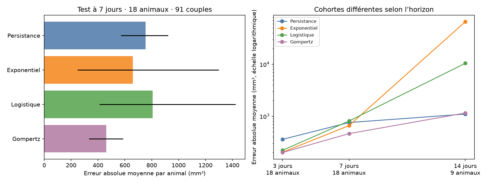

# Résultats de référence — INSPECTumours

Exécution du **3 novembre 2026**, sur le fichier réel INSPECTumours.
Les [définitions des acronymes](../src/tumortwin/glossary.md) sont accessibles
depuis les liens ci-dessous. Aucun résultat synthétique n'entre dans ce bilan.

## Référence reproductible

- Code exécuté : commit `88d108301bc14d24737017685093604cfd606328`.
- Expérience : `758339430817f3bc2acb`.
- Données brutes inchangées : empreinte
  `4f9f55575cf552b2066c4432db295e8c6070c30e2e5a323cf1ea5cb290f79a59`.
- Python 3.14.4 ; SciPy 1.18.1 ; NumPy 2.5.4 ; Pandas 3.1.0 ; Matplotlib 3.11.2.
- Protocole, configuration, code, environnement, split et exemples identifiés
  dans les manifestes de l'expérience. Voir la [provenance de cette synthèse](../reports/phase2_review/provenance.json).

La séparation comporte **104 animaux de développement et 26 de test**, sans
chevauchement, stratifiés par étude et traitement. Le développement a évalué
961 origines, dont 649 principales ; le test 241, dont 163 principales.
Le reste correspond aux analyses des historiques de trois, quatre et cinq mesures.
Les quatre modèles sont ajustés à chaque origine ; les prévisions portent sur
trois horizons exacts. Les origines sans cible restent dans le registre.

## Vérifications effectuées

L'expérience de référence est couverte par **51 tests hors réseau**. Les contrôles
couvrent les formules et dérivées analytiques, croissance/décroissance,
constantes, zéros, débordements, échecs du solveur, séparation reproductible,
cibles exactes, conflits futurs de métadonnées, absence de fuite temporelle,
pondération par animal, support commun, replis explicites, bootstrap apparié
et pipeline miniature avec gel et vérification des empreintes.

Les bornes, départs, tolérances et règles de score du protocole ont été
conservés **sans ajustement après le développement**.

Le marqueur de gel a été créé après achèvement du développement et avant le test.
L'intégrité des 68 artefacts de chaque partition a été vérifiée après exécution.
Les données brutes et les sorties de l'analyse exploratoire n'ont pas été modifiées.

## Critère principal : sept jours

**18 des 26 animaux de test** possèdent au moins une cible exacte à sept jours
après un historique d'au moins six mesures. Cela donne **91 couples
origine/cible**, identiques pour les quatre modèles. La couverture de prévision
valide est de 100 %, ainsi que le support commun ; aucun repli n'a été nécessaire.

| Modèle | [MAE](../src/tumortwin/glossary.md#mae), mm³ | [RMSE](../src/tumortwin/glossary.md#rmse), mm³ | Différence de MAE à persistance, mm³ | Intervalle exploratoire à 95 % de la différence |
| --- | ---: | ---: | ---: | --- |
| Persistance | 754,77 | 891,12 | 0,00 | Référence |
| Exponentiel | 659,28 | 4 881,27 | −95,49 | [−528,83 ; +614,79] |
| Logistique | 807,41 | 4 563,86 | +52,64 | [−329,38 ; +711,51] |
| Gompertz | **461,64** | **643,05** | **−293,14** | **[−397,37 ; −166,34]** |

La moyenne est calculée par animal puis entre animaux ; les longues trajectoires
ne reçoivent pas automatiquement davantage de poids. Les intervalles proviennent
de 2 000 tirages appariés d'animaux, stratifiés par étude, selon le protocole.

**Gompertz présente la plus faible erreur observée à sept jours**, environ
38,8 % de moins que persistance sur ce support. Cette comparaison exploratoire
ne démontre ni une supériorité universelle entre modèles ni une validité clinique.
Les intervalles des différences à persistance pour exponentiel et logistique
incluent zéro. Les très grandes erreurs quadratiques de ces deux modèles révèlent
des extrapolations extrêmes que leur seule erreur absolue moyenne résume mal.

À gauche : erreur à sept jours avec intervalles exploratoires de sa moyenne,
calculés par tirages d'animaux. Les intervalles de **différence appariée** sont
dans le tableau ; ils ne se déduisent pas du chevauchement de ces barres.
À droite : erreurs selon l'horizon, avec une échelle logarithmique pour conserver
la visibilité des fortes extrapolations. Les cohortes changent entre horizons.

## Horizons secondaires

| Horizon | Animaux | Couples par modèle | Persistance, MAE mm³ | Exponentiel | Logistique | Gompertz |
| --- | ---: | ---: | ---: | ---: | ---: | ---: |
| 3 jours | 18 | 44 | 358,43 | 202,61 | 220,73 | 200,00 |
| 14 jours | 9 | 49 | 1 097,82 | 65 994,28 | 10 458,85 | 1 152,51 |

À quatorze jours, l'effectif est inférieur au seuil de dix animaux : aucun
intervalle de bootstrap ni classement robuste n'est annoncé. Les extrapolations
exponentielles et logistiques peuvent devenir disproportionnées. Par exemple,
pour `(Study 2, animal 9)`, depuis le jour 37 vers le jour 51, l'exponentiel prévoit
environ **5,91 millions de mm³**, alors que la mesure fournie vaut **1 mm³**.
Cette prévision est conservée dans les erreurs : elle est numériquement finie,
mais ne constitue pas une prévision biologiquement crédible. Aucun plafond
opportuniste n'a été appliqué après examen de la cible.

La sensibilité aux cohortes est importante : sur l'intersection des trois
horizons, il ne reste que sept animaux et seize origines communes par horizon.
Ces résultats complémentaires ne remplacent pas le critère principal.

## Diagnostics et limites

Les 163 ajustements principaux de test réussissent pour chaque modèle, mais
la convergence n'implique pas l'identification des paramètres :

| Modèle | Alertes d'identification fragile | Alertes de proximité de borne |
| --- | ---: | ---: |
| Exponentiel | 1 / 163 | 100 / 163 |
| Logistique | 66 / 163 | 148 / 163 |
| Gompertz | 49 / 163 | 148 / 163 |

Les alertes de borne sont relatives à des étendues numériques très larges ;
elles ne désignent pas une limite physiologique démontrée. Les avertissements
restent attachés aux prévisions et n'entraînent aucune exclusion des scores.
Les analyses des premiers trois, quatre et cinq points, leurs cohortes
communes, les erreurs relatives et les sous-groupes sont exportés séparément.

Les modèles sont monotones et ne représentent pas les régressions suivies de
reprises. Les faibles volumes rendent les erreurs relatives instables. L'arrêt
du suivi peut être informatif ; les cibles manquantes ne sont pas interpolées.
Les dates de traitement ne sont pas fournies et aucun effet causal n'est estimé.
L'analyse exploratoire a porté sur tout le jeu : la séparation actuelle
n'est pas une évaluation externe aveugle, et trois études ne suffisent pas à
établir la généralisation à une nouvelle étude.

## Accéder aux résultats complets

Le [guide](preclinical_usage.md) décrit les commandes et tous les exports.
La synthèse et sa figure sont versionnées pour lecture sur GitHub ; les
exports complets sont régénérables et restent ignorés par Git. L'identifiant
`758339430817f3bc2acb` et les empreintes de la synthèse désignent l'expérience
de référence ; les exécutions courantes écrivent sous `reports/baselines/`.

Pour reproduire exactement le code exécuté, utiliser le commit `88d1083`, installer
le lock avec uv, télécharger les données puis exécuter split, develop, freeze
et evaluate. Un autre commit crée une nouvelle empreinte d'expérience ; cela ne
signifie pas que le précédent dossier manque ou a été écrasé.
