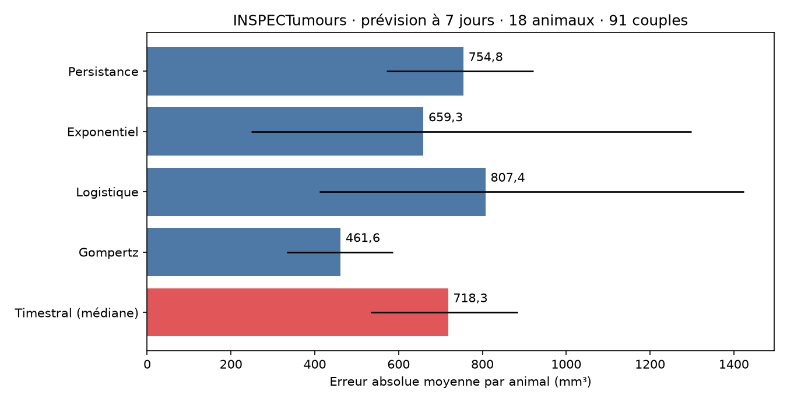
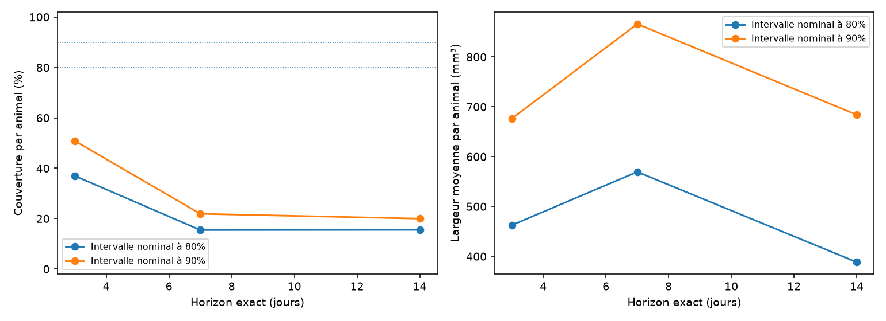

# INSPECTumours — résultats de l'extension Timestral

Exécution du **5 novembre 2026**, expérience `ff719e3185ee39c1c849`, code au
commit `fa6cb28c9c3040533661841a7389deb8e9860022`. Les réglages du
[protocole exploratoire](preclinical_timestral_protocol.md) ont été figés après
le développement et avant le test, sans modification selon les erreurs de test.
Les résultats classiques avaient déjà été consultés avant cette extension.

La [provenance de synthèse](../reports/preclinical_timestral_review/provenance.json)
conserve configuration, versions, révisions du modèle, empreintes et scores.
Le fichier brut reste inchangé : empreinte
`4f9f55575cf552b2066c4432db295e8c6070c30e2e5a323cf1ea5cb290f79a59`.
Les données restent des volumes précliniques en mm³ et des jours après implantation.

## Comparaison principale à sept jours

Même séparation : **104 animaux de développement et 26 de test**, sans recouvrement
de `(study, animal_id)`. Le développement comporte 961 origines, dont 649 principales ;
le test 241, dont 163 principales. Les autres origines correspondent aux analyses
séparées des historiques de trois, quatre et cinq mesures.

Après au moins six mesures passées, **18 animaux** disposent de cibles exactes
à sept jours : **91 couples origine/cible communs aux cinq modèles**. La couverture
numérique est de 100 %, sans repli. Les quatre références reproduisent leurs
scores antérieurs sur les mêmes supports ; leurs réglages n'ont pas changé.

| Modèle | [Erreur absolue moyenne](../src/tumortwin/glossary.md#mae), mm³ | [Racine de l'erreur quadratique moyenne](../src/tumortwin/glossary.md#rmse), mm³ |
| --- | ---: | ---: |
| Persistance | 754,77 | 891,12 |
| Exponentiel | 659,28 | 4 881,27 |
| Logistique | 807,41 | 4 563,86 |
| **Gompertz** | **461,64** | **643,05** |
| Timestral, médiane brute | 718,25 | 847,36 |

Timestral réduit l'erreur absolue moyenne d'environ **4,8 % face à persistance**,
mais présente environ **55,6 % d'erreur supplémentaire face à Gompertz**.
Les différences appariées sont calculées après moyenne par animal, avec 2 000
tirages d'animaux stratifiés par étude :

| Comparaison | Différence d'erreur absolue moyenne, mm³ | Intervalle exploratoire à 95 %, mm³ |
| --- | ---: | --- |
| Timestral moins persistance | −36,52 | [−48,40 ; −24,40] |
| Timestral moins Gompertz | +256,61 | [+134,22 ; +358,12] |

Les intervalles du graphique portent sur les moyennes de chaque modèle ; ils
ne remplacent pas ces intervalles de différences appariées. Le résultat décrit
cette expérience et ne prouve pas une supériorité universelle.

## Prévisions probabilistes brutes

À sept jours, les 91 distributions sont finies et ordonnées. Le score de
[quantiles](../src/tumortwin/glossary.md#quantile)
([pinball loss](../src/tumortwin/glossary.md#pinball-loss)) vaut **271,90 mm³**,
moyenné sur les 21 niveaux, puis par animal.

| Intervalle annoncé | Couverture observée, pondérée par animal | Largeur moyenne, mm³ |
| --- | ---: | ---: |
| 80 % | **15,48 %** | 569,53 |
| 90 % | **21,92 %** | 866,23 |

Les intervalles couvrent beaucoup moins d'observations qu'annoncé : **l'incertitude
brute est mal calibrée sur cette expérience**. Aucun recalibrage n'est appliqué.
Environ 8,11 % des quantiles principaux sont négatifs, ainsi qu'une médiane sur 91.
Ces volumes négatifs sont physiquement inadmissibles ; ils restent dans les scores.
La réussite numérique ne garantit donc ni précision ni admissibilité biologique.

## Horizons secondaires

| Horizon | Animaux | Couples par modèle | Persistance, erreur absolue mm³ | Exponentiel | Logistique | Gompertz | Timestral |
| --- | ---: | ---: | ---: | ---: | ---: | ---: | ---: |
| 3 jours | 18 | 44 | 358,43 | 202,61 | 220,73 | 200,00 | 320,90 |
| 14 jours | 9 | 49 | 1 097,82 | 65 994,28 | 10 458,85 | 1 152,51 | 1 075,76 |

À quatorze jours, Timestral présente la plus faible moyenne observée, mais
l'effectif de neuf animaux est inférieur au seuil du protocole : aucun intervalle
ni classement robuste n'est annoncé. Les cohortes changent entre horizons.

## Contrôles et limites

Les **102 tests hors réseau** utilisent des données explicitement synthétiques.
Ils couvrent notamment absence de fuite temporelle, masques, cibles exactes,
sorties négatives, échecs, quantiles croisés, pondération par animal, supports
communs, différences appariées et parcours miniature jusqu'au gel et au test.
La distribution source et le paquet installable se construisent correctement.

Les 241 inférences de test aboutissent ; les quantiles aux dates demandées sont
finis et ordonnés. Sur les 723 demandes tous contextes et horizons confondus,
trois médianes sont négatives, y compris les demandes sans cible disponible.
La densité médiane observée sur les grilles quotidiennes vaut environ 44,4 %.
Le remplissage interne par la dernière valeur est conservé et documenté.
Poids et code sont figés, sans entraînement ni calibration externe.

Les empreintes des **83 artefacts de chaque partition** ont été vérifiées après
exécution. Une première tentative, interrompue avant ajustement par une restriction
de création des processus, a été conservée séparément dans `failed-attempts/`.

L'évaluation est exploratoire, sur seulement trois études. L'absence de recouvrement
avec le préentraînement n'est pas démontrée. Traitements non datés, attrition et
historiques courts limitent l'interprétation. Aucun effet causal ni usage clinique
n'est établi. Voir le [guide d'exécution](preclinical_usage.md) ; les rapports
complets sont sous `reports/preclinical_timestral/ff719e3185ee39c1c849/`.
